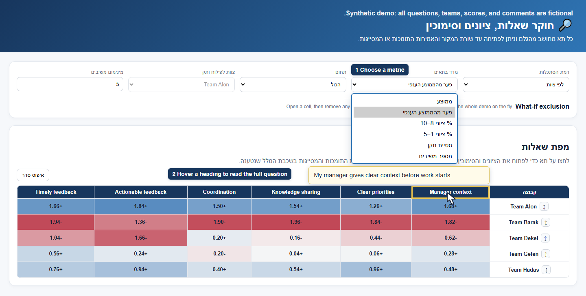
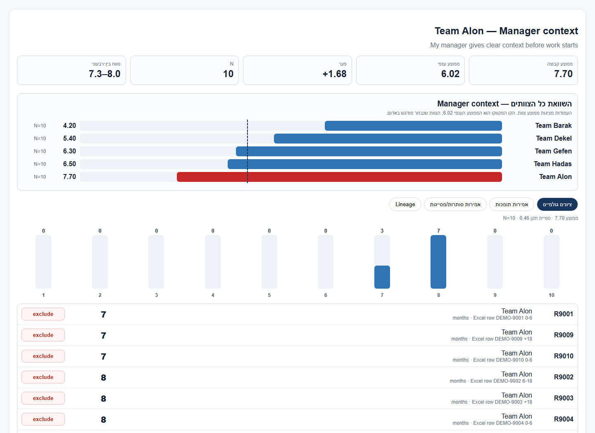
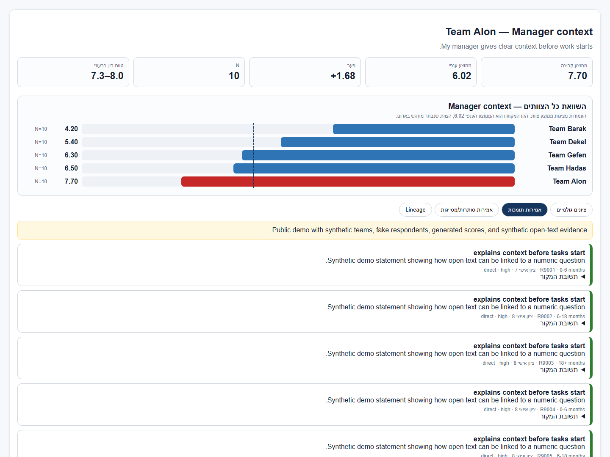
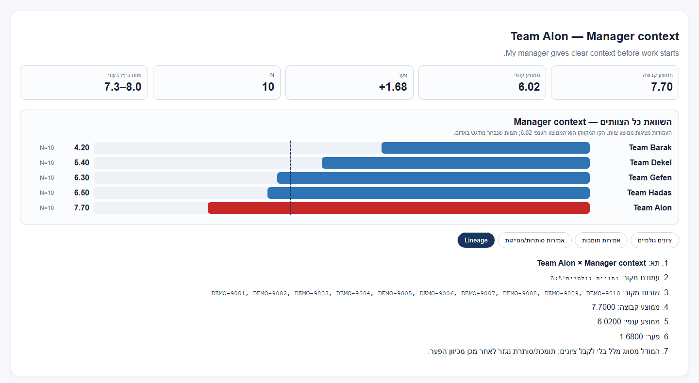

# Survey Question Lineage App

A local survey explorer for tracing a question-level result back to the responses that produced it. The Streamlit interface is in Hebrew. It shows numeric scores, source Excel rows and columns, and, when available, related statements extracted from open-text answers.

## See the interface

These screenshots show the [static public demo](static/public_demo.html). The controls are in Hebrew, with fictional English questions and comments. **All teams, respondents, scores, and comments shown here are synthetic.**

### 1. Compare teams at a glance

Choose a metric from the dropdown, then compare teams in the heatmap. Hover over a column heading to read the full question. The annotated image shows both interaction states together; the heatmap displays each team's difference from the overall average across six example questions.



### 2. Open a result and inspect the scores

Select a cell to see the group's average, response count, comparison with other teams, and raw score distribution. The demo also lets you exclude a respondent temporarily to explore how the result changes.



### 3. Read the comments linked to a result

The evidence tabs show statements classified as supporting or qualifying the numeric result. Each card includes the statement, explanation, and respondent context, with an expandable source answer.



### 4. Trace a result to its source

The Lineage tab lists the source column and response rows, together with the group mean, overall mean, and calculated difference. The demo uses fictional `DEMO-*` source rows.



## What you can explore

- Compare questions across the whole survey, teams, tenure groups, or a team split by tenure.
- Switch between mean score, difference from the overall mean, share of scores 8–10 or 1–5, standard deviation, and response count.
- Select a heatmap cell to inspect its raw score distribution, team comparison, source Excel lineage, and related evidence.
- Filter by survey domain and set a minimum respondent count for each group. Groups below the threshold are hidden.
- View positive and negative open-text statements linked to a question. Their support or contradiction of the numeric result is determined after classification.

## Quick start

Requires Python 3.10 or newer. From the project directory:

```powershell
python -m venv .venv
.venv\Scripts\Activate.ps1
python -m pip install -r requirements.txt
python -m streamlit run app.py
```

On macOS or Linux, activate with `source .venv/bin/activate` instead. `run_app.bat` and `run_app.sh` also create the environment, install dependencies, and start the app.

The app needs a survey workbook. Upload an `.xlsx` file in the sidebar, or put it at `data/survey.xlsx` for local use. If no workbook is available, the app displays an upload prompt.

The original workbook format contains these sheets. Other forms use the local profile format described below.

| Sheet | Required content |
| --- | --- |
| `נתונים גולמיים` | One row per respondent; `צוות` and `זמן בצוות` columns; numeric question columns whose headers match the full question text in the mapping; optional supported open-answer columns. |
| `מיפוי וחישובים` | A question table with `תחום`, `ממד`, `תווית קצרה`, `נוסח מלא`, and `עמודת מקור`. The loader finds the header row automatically. |

The fake CSVs in [`samples/`](samples/README.md) illustrate the expected data shape. They are examples only; the app loads Excel workbooks, not CSV files.

### Other survey forms

The Streamlit sidebar lists local `.xlsx` files under `data/`, so separate surveys can be explored without replacing the original workbook. Local files are initially ordered by filename, descending.

A form with a different layout needs a private `data/<workbook-stem>.profile.json`. The profile identifies the sheet and its exact header fingerprint, group and split fields, question labels and categories, and physical source columns. Multiple role-specific source columns can map to one shared question. Each numeric record retains the actual source column and Excel row. Profile-backed forms validate integer scores from 1 to 10; `zero_is_missing: true` treats 0 as not relevant and excludes it from every numeric calculation and question response count. Small-group thresholds apply to valid scores for each question.

For these forms, the interface uses the configured group/split labels, supports filtering by role and question audience, and recalculates the comparison average within the active role filter. Uploads can use a matching profile already present locally. Changed headers require a reviewed profile update; they are not silently remapped.

Profile-backed surveys use separate `<workbook-stem>_evidence_links.jsonl` and `<workbook-stem>_evidence_status.json` files under `data/`. The batch manifest and parsed evidence carry the workbook fingerprint; the interface refuses evidence for a different workbook version. Use these separate paths with `semantic_batch.py prepare` and `parse`. Preparing requests is local; submitting them sends open answers to the API.

The HTML explorer also supports profile-backed forms. Build a separate private artifact with `python build_demo.py --excel data/<workbook>.xlsx --output data/<workbook>.html`. Add `--serve --port 8502` to open it at `http://127.0.0.1:8502`. This server binds to localhost and serves only the generated HTML. The role selector filters responses and question eligibility; the question-group selector distinguishes shared and role-specific questions. The file is self-contained and embeds the included scores and evidence, so keep it private. Rebuild it after changing the workbook, profile, evidence, or UI.

For a live presentation in the HTML explorer, choose the section/team in the group selector, then check **הסתר שמות מדורים אחרים** (or the team equivalent). The selector is available in every view. The selected group's name stays visible; other names become stable anonymous labels in the table, comparison chart, headings, tooltips, comments, and respondent details. Scores, comparisons, sort order, and manually arranged rows remain unchanged. This is a display option; the HTML still embeds the original private data and must not be shared as an anonymized export.

## Demos

Open [`static/public_demo.html`](static/public_demo.html) directly in a browser to try the interactive explorer with synthetic teams, respondents, scores, and comments. Regenerate it with:

```bash
python build_public_demo.py
```

For a private, self-contained HTML export of a local workbook, run `python build_demo.py`. This writes `static/demo.html`. Treat that output as private survey data; it is ignored by Git.

## Optional open-text evidence

Numeric analysis works without evidence files. To show classified open-text statements alongside scores, upload a matching evidence JSONL file in the sidebar or generate `data/evidence_links.jsonl` with the batch pipeline below. If you upload a different workbook without matching evidence, the app shows numeric lineage only.

Both interfaces also provide a source-answer tab for the respondents included in the selected numeric result. Each open question appears once in a collapsible section, with role labels, response counts, and answers grouped by role. These comments are shown as original answers, without implying that they support the selected question. Importing a workbook does not automatically run evidence classification. The status distinguishes imported free text from classified question links. To restrict batch preparation to specific open questions, repeat `--source-question QUESTION_ID` on the `prepare` command.

The pipeline sends informative open answers and the question catalog to the OpenAI Batch API. It asks the model to split answers into individual statements, match them to questions, and label their direction. **Survey scores are not included in those model requests.** Review your organization's data handling requirements before submitting real responses to the API.

After setting `OPENAI_API_KEY`, run these commands from the project directory (replace `BATCH_ID` with the returned ID):

```bash
python semantic_batch.py prepare --excel data/survey.xlsx --requests data/batch_requests.jsonl --manifest data/open_answer_manifest.csv
python semantic_batch.py submit --requests data/batch_requests.jsonl
python semantic_batch.py status --batch-id BATCH_ID
python semantic_batch.py download --batch-id BATCH_ID --output data/batch_output.jsonl
python semantic_batch.py parse --batch-output data/batch_output.jsonl --manifest data/open_answer_manifest.csv --excel data/survey.xlsx --evidence data/evidence_links.jsonl --status-file data/evidence_status.json --batch-id BATCH_ID
```

For the original workbook, add `--rebuild-demo` to `parse` to update `static/demo.html`. This flag still targets the original workbook; for a profile-backed survey, rebuild explicitly with `build_demo.py --excel ... --output ...` after parsing. Batch preparation and parsing can be run locally; submission, status, and download require API access. Batch jobs run asynchronously; submission is not evidence that classification has completed. See [survey import and evidence operations](docs/SURVEY_IMPORT.md) for the profile schema and separate artifact paths.

## Privacy and project layout

Real workbooks, batch artifacts, evidence files, and `static/demo.html` belong on the local machine and are excluded by [`.gitignore`](.gitignore). The tracked public demo uses generated data. Keep any exported HTML containing real survey data private.

The generic local workbook filename is `data/survey.xlsx`. The public demo uses fictional questions as well as fictional responses; it never loads the local workbook. See [the publication privacy review](PRIVACY_REVIEW.md) for scope and limitations.

For different open-question headers, an optional local `data/open_question_columns.json` can map the keys `manager_keep`, `manager_change`, `team_jump`, and `team_keep` to your workbook's column names. This file is excluded from publication.

Before publishing, run `python scripts/check_public_release.py --staged`. The check scans the exact staged files against the public-file allowlist, rejects common secrets and personal metadata, and verifies that the embedded demo data matches the synthetic generator. Enable local commit and push checks with `git config core.hooksPath .githooks` and configure your GitHub noreply email with `git config user.email YOUR_GITHUB_NOREPLY_ADDRESS`. The push hook permits only `main` and checks every commit it would publish. GitHub also runs the check on pushes and pull requests; CI detects a leak after a push and cannot prevent its initial publication. Add a required status check in your repository rules if you want GitHub to enforce a passing check before merging. Hooks can be bypassed and do not replace review.

| File | Purpose |
| --- | --- |
| `app.py` | Streamlit interface and drill-down. |
| `survey_loader.py` | Excel parsing and normalized response records. |
| `metrics.py` | Matrix metrics, grouping, and score distributions. |
| `semantic_batch.py`, `evidence.py` | Evidence generation, loading, and joining to responses. |
| `build_demo.py`, `build_public_demo.py` | Private and synthetic static HTML builders. |

See [current status](STATUS.md), [session handoff](SESSION_HANDOFF.md), [architecture](ARCHITECTURE.md), and [validation](VALIDATION.md). Run the tests with `python -m pytest -q`.
